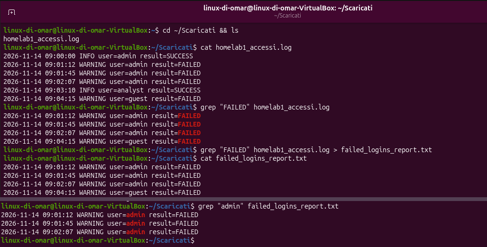
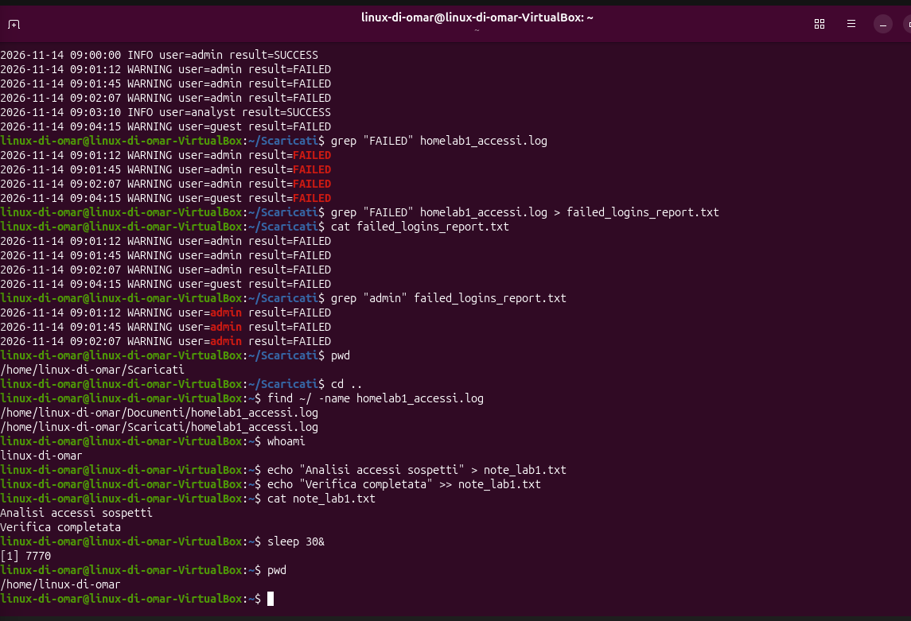

# Linux Fundamentals Part 1 – Home Lab

## 1. Project Overview

This home lab documents my practical learning experience with Linux Fundamentals Part 1 from TryHackMe.

I used Ubuntu running on Oracle VirtualBox to practice basic Linux commands and perform a simulated security log investigation.

The goal was to identify failed login attempts, generate a report, and develop foundational Linux skills relevant to Blue Team and SOC operations.

## 2. Lab Environment

- **Operating System:** Ubuntu Linux
- **Virtualization:** Oracle VirtualBox
- **Interface:** Bash terminal
- **Training:** TryHackMe – Linux Fundamentals Part 1
- **Data:** Simulated authentication logs

## 3. Linux Commands Practiced

| Command | Purpose |
|---|---|
| `whoami` | Identify the current user |
| `pwd` | Display the current working directory |
| `ls` | List files and directories |
| `cd` | Navigate between directories |
| `cat` | Display file contents |
| `find` | Search for files |
| `grep` | Search for matching text |
| `echo` | Output text and create simple file content |

**Shell operators practiced:**

- `>` – Redirect output to a file, overwriting existing content.
- `>>` – Append output without overwriting existing content.
- `&&` – Execute the next command only if the previous command succeeds.
- `&` – Run a command in the background.

## 4. Practical Investigation

### Step 1 – Inspecting the log

I examined the simulated authentication log using:

`cat homelab1_accessi.log`

### Step 2 – Identifying failed logins

I filtered the log to identify failed authentication attempts:

`grep "FAILED" homelab1_accessi.log`

### Step 3 – Generating a security report

I created a report containing only the failed login attempts:

`grep "FAILED" homelab1_accessi.log > failed_logins_report.txt`

I verified the generated report with:

`cat failed_logins_report.txt`

### Step 4 – Investigating the administrator account

I filtered the report to identify failed login attempts involving the administrator account:

`grep "admin" failed_logins_report.txt`

### Step 5 – Additional Linux practice

I searched for the log file:

`find ~/ -name homelab1_accessi.log`

I also practiced creating and appending text:

`echo "Analisi accessi sospetti" > note_lab1.txt`

`echo "Verifica completata" >> note_lab1.txt`

Finally, I tested background execution:

`sleep 30 &`

The terminal remained available for additional commands.

## 5. Investigation Results

| Finding | Result |
|---|---|
| Total authentication events | 6 |
| Successful logins | 2 |
| Failed logins | 4 |
| Failed administrator logins | 3 |
| Failed guest logins | 1 |

Three failed authentication attempts targeted the `admin` account within 55 seconds.

This pattern may indicate suspicious authentication activity, such as password guessing. However, the available evidence is insufficient to confirm an attack.

## 6. Terminal Evidence

The following screenshots show commands I executed in my Ubuntu virtual machine.

**Log analysis and report generation**

**Linux commands, file searching, redirection, and background execution**

## 7. Repository Files

- `homelab1_accessi.log` – Simulated authentication events.
- `failed_logins_report.txt` – Report generated through Linux command-line filtering.
- `homelab1-terminal-analisi-completa.png` – Evidence of log analysis.
- `homelab1-comandi-linux.png` – Evidence of additional Linux commands.
- `README.md` – Lab documentation.

## 8. Conclusion

This home lab helped me strengthen my understanding of Linux command-line fundamentals, file navigation, text filtering, output redirection, and basic security log analysis.

The authentication data is simulated, while the terminal commands, report generation, and screenshots document my hands-on practice.

This project represents the first stage of my practical cybersecurity learning journey, focused on developing foundational skills for Blue Team and SOC operations.
